<!-- Cards use embedded fonts and SVG animation. Keep each three-card row on one line. -->

 
 
 
 
<picture><source media="(prefers-color-scheme: dark)" srcset="./cards/title-dark.svg" /></picture> 

<a href="https://linkedin.com/in/antonio-potenza-345b551a7/">linkedin</a> &nbsp;/&nbsp; <a href="https://instagram.com/_potenzaantonio_">instagram</a> &nbsp;/&nbsp; <a href="https://github.com/antoniopotenza19?tab=repositories">repositories</a> &nbsp;/&nbsp; <a href="./assets/antonio-cartoon.png">portrait</a>

Background & tools

I'm a Data Science and Computer Engineering student at **Politecnico di Torino**, focused on systems that transform industrial machine data into real-time insights.

My work includes PLC programming, SCADA systems, industrial dashboards, machine telemetry pipelines, data analytics and predictive maintenance. My current focus is industrial monitoring platforms, anomaly detection and SCADA web dashboards.

**Stack:** Python · FastAPI · React · PostgreSQL · TimescaleDB · Docker · C · MySQL · Visual Studio.

**Industrial SCADA Web Platform:** real-time compressor monitoring, alarm management, energy dashboards and time-series visualization.

**Data Science & Simulation:** stochastic processes, epidemic models, random graphs and time-series forecasting with NumPy, Pandas and Matplotlib.

Inspired by [Avi Vashishta's profile](https://github.com/AVIVASHISHTA29). [How this README works](./MAINTENANCE.md).

