<!-- Cards use embedded fonts and SVG animation. Keep each three-card row on one line. -->

 
 
 
 
<picture><source media="(prefers-color-scheme: dark)" srcset="./cards/title-dark.svg" /></picture> 

 &nbsp;
 &nbsp;

