<div align="center">

### `antonio@github ~ $ ./contributions.sh`



<br><br>

### `antonio@github ~ $ whoami`

<table>
  <tr>
    <td valign="top"></td>
    <td valign="top"></td>
  </tr>
</table>

<a href="https://linkedin.com/in/antonio-potenza-345b551a7/">LinkedIn</a> &nbsp;·&nbsp;
<a href="https://instagram.com/_potenzaantonio_">Instagram</a> &nbsp;·&nbsp;
<a href="https://github.com/antoniopotenza19?tab=repositories">Repositories</a>

</div>

<br>

### `antonio@github ~ $ cat projects.txt`

**Industrial SCADA Web Platform**<br>
Real-time compressor monitoring, alarm management, energy dashboards and time-series visualization.<br>
`Python` · `FastAPI` · `React` · `TimescaleDB` · `Docker`

**Data Science & Simulation**<br>
Stochastic processes, epidemic models, random graphs and time-series forecasting.<br>
`Python` · `NumPy` · `Pandas` · `Matplotlib`

**Industrial & Data Skills**<br>
PLC programming · SCADA systems · Industrial dashboards · Machine telemetry pipelines · Predictive maintenance

**Additional tools**<br>
`C` · `MySQL` · `Visual Studio`

<details>
<summary>About this README</summary>

The calendar uses real data from GitHub's public contributions endpoint and refreshes daily at 06:17 UTC through [GitHub Actions](https://github.com/antoniopotenza19/antoniopotenza19/actions/workflows/update-profile-art.yml). No personal token or external stats service is required. GitHub may delay scheduled runs.

The portrait and profile card are self-contained animated SVGs. Reduced-motion preferences show the finished artwork immediately.

Edit [`profile.json`](./profile.json) to update the card. To regenerate everything locally:

```sh
python -m pip install -r scripts/requirements-art.txt
python scripts/fetch_contributions.py
python scripts/render_profile.py
```

The portrait crop is tailored to the current avatar; adjust `portrait()` in `scripts/render_profile.py` when replacing `avatar.png`.

Inspired by [Avi Vashishta's animated profile README guide](https://www.avivashishta.com/blog/build-animated-github-profile-readme). Implementation written for this profile.

</details>
